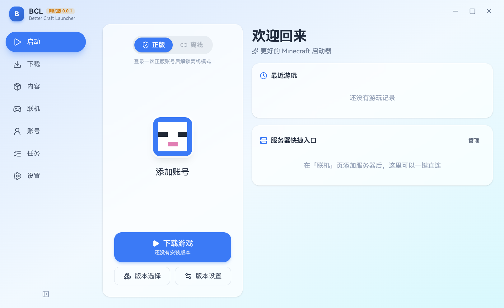
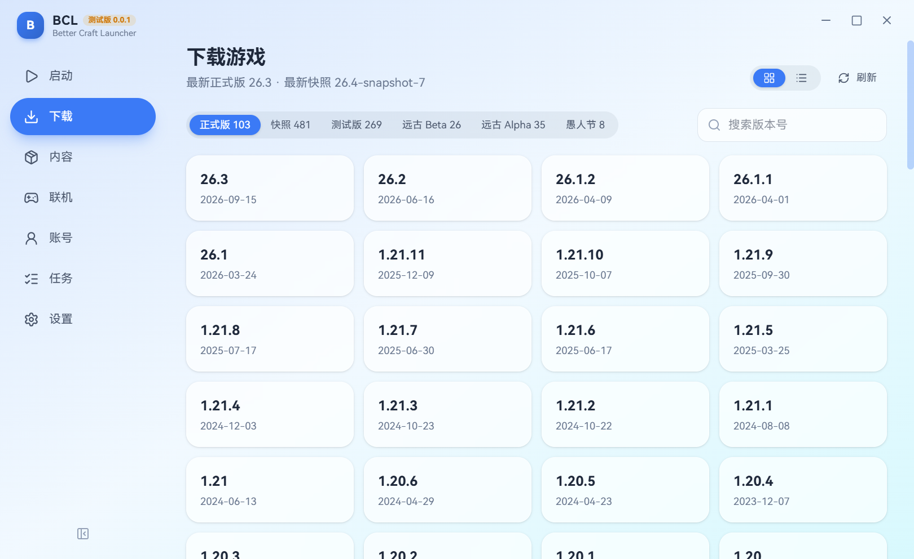
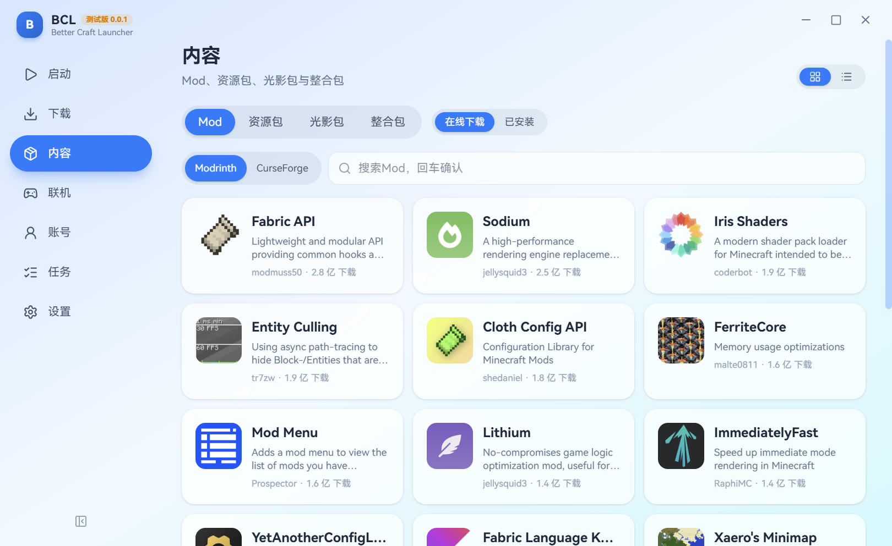
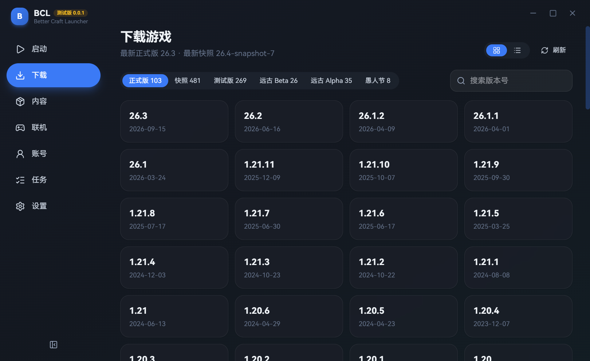
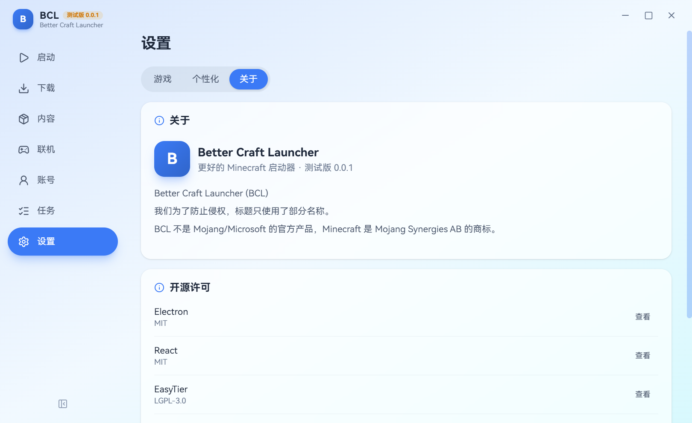

# Better Craft Launcher (BCL)

**中文** | [English](#english)

更好的 Minecraft 启动器 —— 一个第三方 Minecraft 启动器。目前支持 Java 版和 Windows，之后计划支持 macOS 和 Linux。

> BCL 不是 Mojang/Microsoft 的官方产品，未获得 Mojang 或 Microsoft 的认可，也与其没有关联。Minecraft 是 Mojang Synergies AB 的商标。
> 我们为了防止侵权，标题只使用了部分名称。

## 当前状态

测试版 0.0.1，目前仅支持 Windows 10 / 11（64 位），macOS 和 Linux 版本在计划中。微软正版登录使用的 Azure 应用正在等待 Mojang 审核，通过后会在发布版中直接启用。

## 功能

- **下载游戏**：正式版、快照、测试版、远古 Beta / Alpha、愚人节版；国内用户可用 BMCLAPI 镜像，失败自动回退官方源
- **Mod 加载器**：Fabric、Quilt、Forge（含 1.12.2 及更早的旧版）、NeoForge
- **内容**：从 Modrinth / CurseForge 安装 Mod、资源包、光影包和整合包（.mrpack），自动安装前置 Mod；已安装的内容可以启用、禁用、删除
- **正版登录**：微软账号登录（在弹出的窗口中登录，也可以改用浏览器输入代码）
- **联机**：内置 EasyTier 异地联机（不需要管理员权限）；服务器列表显示延迟、人数和 MOTD，一键直连；自动发现局域网世界
- **Java**：自动扫描本机 Java 并按游戏版本选择，缺少时自动下载 Mojang 官方运行时
- **界面**：侧边栏 / 仅图标 / 顶部导航三种布局，浅色 / 深色 / 跟随系统，自定义主题色、背景图和界面缩放

## 截图

| 下载游戏 | Mod 与整合包 |
| --- | --- |
|  |  |
| **深色模式** | **关于** |
|  |  |

## 下载

在 [Releases](../../releases) 页面下载最新版本：

- `BCL-Setup-版本号.exe`：安装版。不需要管理员权限，卸载时不会删除游戏文件（.minecraft）
- `BCL-Portable-版本号.exe`：便携版，不用安装，直接运行

## 正版验证与合规

- **必须拥有正版**：离线模式只有在用一个拥有 Minecraft: Java 版的微软账号成功登录过一次之后才会解锁。登录时会向 Minecraft 服务读取游戏档案，没有档案的账号不能解锁离线模式
- **不分发游戏文件**：安装包里不包含任何 Minecraft 游戏文件。所有游戏文件都在用户电脑上从 Mojang 官方源（或 BMCLAPI 镜像）下载
- **尊重 Mod 作者**：CurseForge 上禁止第三方分发的文件，会跳转到网页由用户手动下载
- **开源组件**：使用的开源组件及其许可证列在「设置 → 关于 → 开源许可」中

## 隐私

- 微软登录走微软官方的 OAuth 2.0 流程（授权码 + PKCE，或设备代码），只申请 `XboxLive.signin` 和 `offline_access` 权限。BCL 不会接触你的微软账号密码
- 登录凭据只保存在你自己的电脑上，并用操作系统自带的加密功能保存
- BCL 不收集任何使用数据，也没有统计、遥测或广告

## 反馈

遇到问题或有建议，请在 [Issues](../../issues) 中提出。

---

# Better Craft Launcher (BCL) — English

[中文](#better-craft-launcher-bcl) | **English**

A better launcher for Minecraft — a third-party Minecraft launcher. It currently supports Java Edition on Windows, with macOS and Linux planned.

> BCL is NOT an official Minecraft product. It is not approved by or associated with Mojang or Microsoft. Minecraft is a trademark of Mojang Synergies AB.
> To avoid trademark infringement, our product name intentionally uses only part of the name.

## Status

Beta 0.0.1, currently Windows 10 / 11 (64-bit) only; macOS and Linux versions are planned. The Azure app used for Microsoft sign-in is awaiting Mojang's review and will be enabled in release builds once approved.

## Features

- **Game versions**: releases, snapshots, pre-releases / release candidates, old Beta / Alpha and April Fools versions; optional BMCLAPI mirror for users in mainland China, with automatic fallback to official sources
- **Mod loaders**: Fabric, Quilt, Forge (including 1.12.2 and older) and NeoForge
- **Content**: install mods, resource packs, shader packs and modpacks (.mrpack) from Modrinth / CurseForge, with required dependencies installed automatically; enable, disable or remove installed content
- **Microsoft account sign-in**: sign in in a pop-up window, or with a device code in your browser
- **Multiplayer**: built-in EasyTier for playing with friends over the internet (no admin rights needed); server list with ping, player count and MOTD; automatic LAN world discovery
- **Java**: detects installed Java runtimes and picks one per game version; downloads Mojang's official runtime when none fits
- **UI**: sidebar / icon-only / top navigation layouts, light / dark / system theme, custom accent color, background image and UI scale

## Screenshots

See the screenshots in the Chinese section above (the UI is currently Chinese only).

## Download

Get the latest build from [Releases](../../releases):

- `BCL-Setup-<version>.exe`: installer. No admin rights needed; uninstalling never deletes your game files (.minecraft)
- `BCL-Portable-<version>.exe`: portable build, runs without installation

## Ownership verification & compliance

- **A legitimate copy is required**: offline mode is locked until the user has successfully signed in once with a Microsoft account that owns Minecraft: Java Edition. During sign-in BCL reads the player's Minecraft profile, and accounts without a profile cannot unlock offline mode
- **No game files are distributed**: BCL ships no Minecraft game files. Every game file is downloaded on the user's own computer from Mojang's official servers (or the BMCLAPI mirror)
- **Respect for mod authors**: CurseForge files whose authors disallow third-party distribution are opened in the browser for manual download
- **Open-source components**: listed with their licenses under Settings → About → Open-source licenses

## Privacy

- Microsoft sign-in uses Microsoft's official OAuth 2.0 flow (authorization code with PKCE, or device code) and requests only the `XboxLive.signin` and `offline_access` scopes. BCL never sees your Microsoft password
- Sign-in tokens are stored only on your computer, encrypted with the operating system's built-in data protection
- BCL collects no usage data and contains no analytics, telemetry or ads

## Feedback

Please report problems or suggestions in [Issues](../../issues).
